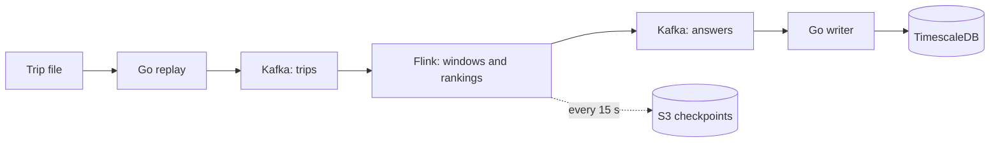

# Distributed Streaming pipeline with Kafka and Flink

This project replays a full year of New York taxi trips (173 million records), through Kafka and Flink on a small AWS cluster at 50,000 trips a second. As the trips stream in, it maintains two live top 10 lists that answer 2 questions - Q1 and Q2 (see below). The 4.5 million answers are checked against a reference answer set that was produced beforehand via a Python script.

The project uses Terraform. Builds the code, creates the cluster, runs the benchmark, checks the answers, saves the evidence and tears everything down.

To understand why exact answers are hard on a distributed stream and what made this one fast, read the blog post.

## Queries

The queries come from the DEBS 2015 Grand Challenge.

**Most frequent routes (Q1)**. The ten most common routes over the last 30 minutes, where a route is a pickup cell and a drop-off cell on a grid laid over the city.

**Most profitable areas (Q2)**. The ten areas where an empty taxi can expect to earn the most right now. An area’s score is the median fare plus tip of trips that started there in the last 15 minutes, divided by the number of taxis that dropped someone off there in the last 30 minutes and haven’t picked anyone up since.

The trips are rebuilt from the city's 2013 trip and fare archives: the files are joined, bad rows are set aside and counted, and the result is sorted by drop-off time. It's a reconstruction since I couldn't find the original contest file.

## Results

| Latency | Q1 · routes | Q2 · areas |
| --- | ---: | ---: |
| p50 | 80 ms | 86 ms |
| p95 | 96 ms | 128 ms |
| p99 | **154 ms** | **192 ms** |

All 173,176,321 trips went through at a sustained 50,000 per second, and all 4,540,080 answers matched the reference. Flink saved a checkpoint every 15 seconds throughout, with no failures and no restarts. The measured run cost about $2 in compute.

Latency is measured from the moment Kafka stores a trip to the moment it stores the answer it triggered. Not every trip changes a top ten, so there are fewer answers than trips. Copying answers into the Timescale database added up to 413 ms at p99.

**Recovery** was checked in separate test runs that killed a Flink worker process, stopped a Kafka broker, took down the database and its writer, and killed the producer mid-stream so it resent 2,128 trips. Each time, both answer fingerprints still matched, no trip that Kafka had accepted went missing, and no conflicting answer reached the database. Flink had caught up with its backlog 41.5 seconds after the worker was killed. These tests cover a process failing on a running cluster. Losing a whole machine wasn't tested, and the Flink JobManager has no standby.

## How it works



A Go producer replays the trip file into Kafka at a fixed rate. Each taxi always lands on the same partition, so if the producer crashes and resends some trips, they arrive in the same place and Flink's first step drops anything it has already seen.

Flink keeps the windows in memory. Because a trip from 10:29 might still be making its way through a slower partition, Flink only closes a point in time once every input has moved past it i.e. watermarks.

Each query's ranking is split into 24 shards. A shard sends its own top ten only when it changes, and a single global step per query merges those short lists into the final answer. This stays exact because anything outside a shard's top ten can't make the overall top ten.

Waiting for every partition and merging the shards does cost something. In a separate Query 1 test on the first 10 million trips, a diagnostic mode that skipped both i.e. publishing each shard's top ten the moment it changed, reached 64 ms at p99 against 103 ms for the exact pipeline. Treat the 39 ms gap as a rough price for exactness: the diagnostic answers aren't the real top ten, can't be checked against the reference, and form a different set of answers.

Answers go back to Kafka "at least once," so a failure can produce a duplicate. Each answer's ID is a hash of its content, which lets the Go writer skip anything it has already stored in TimescaleDB.

To measure exactness, some rules: money is kept in whole cents, a median of an even number of fares keeps its half cent, profitability is compared as an exact fraction, and ties are broken in a fixed order. The Python reference follows those rules without sharing any code with the pipeline.

## AWS Cluster

Region `us-east-1`.

| Role | Count | Instance |
| --- | ---: | --- |
| Control node and Flink JobManager | 1 | `c7g.xlarge` |
| Kafka brokers | 3 | `m7g.large` |
| Flink workers | 4 | `c9g.xlarge` |
| TimescaleDB | 1 | `r7g.large` |
| **Total** | **9** | **28 vCPUs** |

| Setting | Value |
| --- | --- |
| Kafka partitions / Flink source readers | 4 / 4 |
| Flink processing tasks / ranking shards per query | 8 (two per worker) / 24 |
| Flink state | In-memory (HashMap), no managed memory |
| Watermark alignment | 60 minutes of taxi time |
| Out-of-order allowance | None |
| Checkpoints | Every 15 s, to S3 |
| Network buffer timeout | 5 ms |
| Kafka replication / minimum in-sync replicas | 3 / 2 |
| Database writer batches | Up to 1,000 rows, flushed every 100 ms |

These live in [config/release.json](config/release.json) and can't be changed from the command line, so every run measures the same thing. [versions.env](versions.env) pins the software images. Before any trips are sent, the runner checks the key settings on the live cluster, including the buffer timeout and where Flink placed its tasks.


## Running it

You'll need:

- Docker with ARM64 build support, AWS CLI v2, Python 3, Git and Make
- An AWS profile that can create resources in `us-east-1`, with C9g instances available and quota for atleast 28 standard vCPUs
- The prepared dataset and its manifest, which are kept out of Git

The tools in [data/tools](data/tools) download the city's two archives and rebuild the dataset. The [example manifest](config/dataset-manifest.example.json) shows the checksums and source details the finished file should have. By default the runner looks for:

```text
data/prepared/full/reconstructed-foil.csv.zst
data/prepared/full/data-manifest.json
```

Start with a check. It validates the repository, and the dataset if you point it at one, without creating anything in AWS:

```bash
./benchmark check

./benchmark check --small-run \
  --dataset /absolute/path/to/reconstructed-foil.csv.zst \
  --manifest /absolute/path/to/data-manifest.json
```

Then try the 10-million-trip subset. **This creates real AWS resources.**

```bash
./benchmark run --small-run \
  --aws-profile YOUR_PROFILE \
  --dataset /absolute/path/to/reconstructed-foil.csv.zst \
  --manifest /absolute/path/to/data-manifest.json
```

Leave out `--small-run` to replay the full year. Always pass `--aws-profile`; without it, the runner uses a profile named `dev-user`.

| Mode | Trips | Warm-up at 20,000/s | Measured at 50,000/s |
| --- | ---: | ---: | ---: |
| Subset | 10,000,000 | 1,600,000 | 8,400,000 |
| Full | 173,176,321 | 3,200,000 | 169,976,321 |

Both modes use the same cluster and settings, and each has its own frozen reference. Before creating anything, the runner compares a worst-case cost estimate with a cap of $3 for the subset or $15 for the full run, and stops if the estimate is higher.

During a run - The runner builds the code, deploys the cluster with Terraform and checks that it's ready. It warms up with real trips, then pauses, lets every queue drain and takes a checkpoint, so startup noise stays out of the measurement. After the measured replay it verifies every answer, exports the raw timing trace before analyzing it, and downloads the reports to `.runs/RUN_ID/`. Finally it destroys the cluster and checks that nothing was left behind. A separate EventBridge timer will terminate the instances if the runner dies partway through.


To look at, continue or clean up a run (`status` and `cleanup` use the latest run if you leave out `--run-id`):

```bash
./benchmark status --run-id RUN_ID
./benchmark run --resume RUN_ID --aws-profile YOUR_PROFILE
./benchmark cleanup --run-id RUN_ID --aws-profile YOUR_PROFILE
```

`--resume` picks up an unfinished run where the runner left off. It can't bring back a cluster that has already been torn down.


## Working on the code

```bash
make build
make test
make check
make clean
```

`make check` runs the tests plus shell, Python and Terraform checks. It's more thorough than `./benchmark check`, which is a quick preflight.

| Path | What's there |
| --- | --- |
| `aws_benchmark/` | The runner: configuration, builds, orchestration, evidence and analysis |
| `infra/terraform/`, `infra/cloud-init/`, `infra/runtime/` | AWS resources, node setup, and the scripts that run on the cluster |
| `producer/` | Go replay producer and output verification |
| `processor/flink/` | The Flink job: input checks, windows, timing and rankings |
| `processor/reference/` | The independent Python reference |
| `materializer/`, `database/migrations/` | Go database writer and the database schema |
| `data/tools/` | Dataset download, reconstruction and validation |
| `config/`, `schemas/` | Frozen settings, reference fingerprints and shared test vectors |
| `tests/` | Tests for the runner and the run lifecycle |

